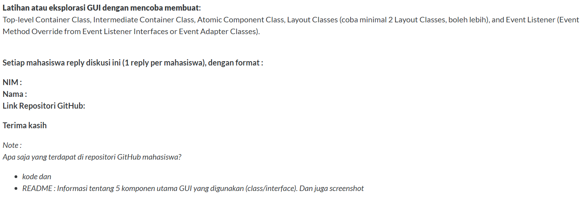

# GUI Form Data Mahasiswa

## Deskripsi
Program ini merupakan aplikasi GUI sederhana menggunakan
Java Swing untuk memasukkan dan menampilkan data mahasiswa.

## 5 Komponen Utama GUI

### 1. Top-level Container Class
JFrame digunakan sebagai jendela utama aplikasi.

### 2. Intermediate Container Class
JPanel digunakan sebagai wadah untuk mengelompokkan
komponen GUI.

### 3. Atomic Component Class
Komponen yang digunakan:
- JLabel
- JTextField
- JButton
- JComboBox
- JRadioButton
- JCheckBox
- JTextArea

### 4. Layout Classes
Layout yang digunakan:
- BorderLayout
- GridBagLayout
- FlowLayout

### 5. Event Listener
Menggunakan ActionListener dengan override method
actionPerformed() untuk menangani tombol Simpan dan Reset.

## Cara Menjalankan
1. Pastikan Java JDK sudah terinstal.
2. Buka project menggunakan IDE Java.
3. Jalankan FormMahasiswa.java.
4. Aplikasi akan menampilkan formulir data mahasiswa.

## Screenshot Aplikasi

